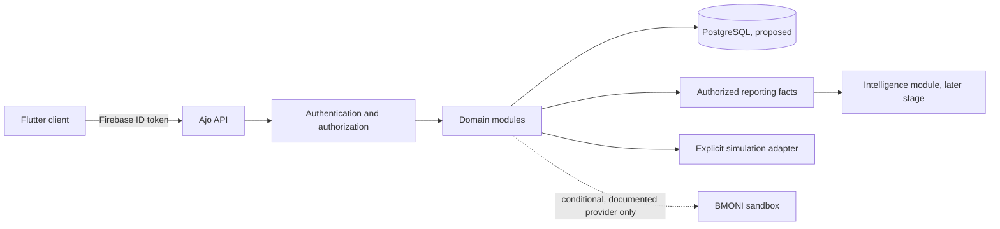

# Ajo Stage 1 Architecture Decisions

- **Status:** Team-approved architecture baseline; bounded feature-specific decisions remain gated
- **Product:** Ajo, TINC26 x BMONI Hackathon
- **Baseline:** `cf4047a481b63f81e12851674bbbd9963508163c`
- **Inspected checkout:** `feat/ajo-backend-stage-1`, clean at the baseline commit
- **Scope:** Architecture and contract decisions only; no service or financial behavior implemented

## 1. Purpose and exit gate

This document records the team-approved architecture baseline and MVP policy decisions reported on 2026-10-15, together with feature-specific decisions that remain gated. Stage 2 foundation and identity work are authorized; later modules must satisfy their own API-contract and policy gates.

This approval does not itself authorize implementation of financial mutations, Flutter cutover, provider requests, deployment, or model integration. Those require their documented feature gates and any separate operational authorization.

## 2. Verified baseline

The audited repository is a Flutter/Dart application. It currently provides:

- Firebase Core initialization and Google sign-in in the client.
- A process-local `AjoStore` seeded with the ten-member, ten-round demo scenario.
- Integer-kobo client models and deterministic ledger, reliability, and reminder calculations.
- A simulated payment adapter and a local timer-based payout demonstration.
- A deterministic, read-only, keyword/template assistant.

The checkout contains no backend service, database schema or migrations, API specification, server-side Firebase token verification, or model runtime. The client repository files and BMONI sandbox adapter are empty. `Dio` is a dependency but no HTTP API integration was found. Flutter checks could not be run in the audit environment because the Flutter/Dart executables and resolved package configuration were unavailable.

The demo is a UI and behavior reference, not an authoritative financial system. Preserve it until a separately approved Flutter integration stage replaces its local data path.

## 3. Proposed architecture

### Approved direction: modular monolith

Use one deployable Ajo API with explicit internal modules. Keep authentication, domain rules, payment adapters, reporting, and intelligence within that backend boundary initially. Do not add microservices, Redis, a message broker, or a separate AI service without a demonstrated requirement.

The intelligence module consumes purpose-built, authorized reporting facts. It has no unrestricted database access and no mutation capability for money or payout state.

### Team-approved backend stack baseline

| Decision | Recommendation | Status |
|---|---|---|
| Backend language/framework | Python + FastAPI | Team-approved, as reported by requester on 2026-10-15 |
| Database | PostgreSQL | Team-approved, as reported by requester on 2026-10-15 |
| ORM/migrations | SQLAlchemy + Alembic | Team-approved, as reported by requester on 2026-10-15 |
| Validation | Pydantic | Team-approved, as reported by requester on 2026-10-15 |
| Firebase verification | Firebase Admin SDK on the server | Team-approved, as reported by requester on 2026-10-15 |
| Tests | Pytest plus PostgreSQL-backed integration tests | Team-approved, as reported by requester on 2026-10-15 |
| Architecture | Modular monolith | Team-approved, as reported by requester on 2026-10-15 |
| Backend repository location | Existing repository, under `backend/` | Team-approved, as reported by requester on 2026-10-15 |
| Hosting/deployment | Choose based on team access and delivery time | **Open; do not infer** |

The team-approved Python stack lets backend and deterministic intelligence work share a runtime. Pin a compatible dependency set before implementation.

## 4. Logical ownership boundaries

These are logical modules, not separate services. Exact package paths will be established under the approved same-repository `backend/` layout during foundation work.

| Module | Owns |
|---|---|
| `auth` | Firebase token verification, Firebase UID to internal-user mapping, request identity |
| `users` | Persisted profile and preferences |
| `circles` | Circle lifecycle, membership, invitations, roles, rule versions and acceptance |
| `schedules` | Period creation, due dates, grace policy, payout-order locking |
| `ledger` | Obligations, append-only financial events, allocations, derived contribution states |
| `payments` | Intents, mode selection, idempotency, simulation adapter, provider reconciliation |
| `payouts` | Eligibility, approval authorization, processing, settlement and exceptions |
| `reporting` | Access-filtered summaries and deterministic facts for client and assistant |
| `intelligence` | Question handling and explanations over authorized facts; no financial mutations |
| `reminders` | Consent, scheduling, delivery attempts and delivery state |
| `disputes` | Dispute lifecycle, decisions and linked audit evidence |
| `audit` | Sensitive administrative and financial actions, actor and before/after evidence |
| `api` | Versioned routes, schemas, request context and common errors |

## 5. Trust and authority decisions

1. **Firebase establishes the mobile sign-in identity.** A backend must verify each Firebase ID token and map its verified UID to an internal Ajo user. Firebase client configuration is not authorization.
2. **The backend owns persisted product facts.** Membership, permissions, rules, schedules, obligations, confirmed amounts, payout order, payout transitions, and reportable reliability facts are server-owned.
3. **PostgreSQL is the approved persistence authority.** Constraints and transactions must protect high-value invariants, in addition to application-level validation.
4. **Flutter owns temporary presentation state only.** It may display a pending action, but cannot establish payment confirmation, authoritative balance, payout settlement, role, or payout order.
5. **Payment evidence is mode-specific.** In simulation mode, only an explicitly authorized simulated event may confirm a synthetic payment. In BMONI mode, only verified provider evidence or approved reconciliation may do so. Provider failure never falls back to simulated success.
6. **Intelligence is read-only.** The backend authorizes and constructs its fact bundle before any assistant processing. Neither the assistant nor its model may mutate ledger or payout state.

## 6. Data and wire conventions

| Concern | Proposed convention |
|---|---|
| Money | Integer kobo on storage and wire; no floating-point financial values |
| Instants | RFC 3339 UTC timestamps on the API; display conversion belongs to the client |
| Identifiers | Stable opaque API identifiers; never expose demo IDs such as `me` or `m1` as durable IDs |
| API version | `/v1` prefix |
| Authentication | `Authorization: Bearer <Firebase ID token>` on protected requests |
| Content | JSON request and response bodies |
| Mutations | Persistent idempotency for financial operations and other retry-sensitive actions |
| Errors | One machine-readable envelope, safe user-facing message, and request ID |
| Pagination | Cursor-based for potentially growing collections |
| Operating mode | Explicit response value distinguishing `simulated` from `sandbox` where payment UX depends on it |
| Unknown enum value | Must not be interpreted as a successful or authorized financial state; client should fail safely |

These conventions are proposals for review, not existing repository behavior.

## 7. Flutter compatibility notes

- Current client state uses `me` and `m1`-style fixture IDs. Treat them as demo-only and map server identities explicitly.
- Dart enums use camelCase members; the proposed JSON contract uses documented snake_case strings. Do not silently conflate them.
- Client amounts already use integer kobo. Preserve this across API serialization.
- Client `DateTime.now()` values are local process timestamps. The API uses UTC instants; schedule/deadline interpretation uses the approved `Africa/Lagos` timezone and 24-hour grace policy.
- The current client payment adapter only models `submitted`, `confirmed`, and `failed`; it is not a server payment-intent or webhook contract.
- Current repository/controller seams are not implemented API clients. The approved integration stage must decide how these seams are filled without broad UI rewrites.

## 8. Approval register

| Decision | Proposed default | Approval state | Owner |
|---|---|---|---|
| Backend framework and supporting stack | Python + FastAPI, PostgreSQL, SQLAlchemy/Alembic, Pydantic, Firebase Admin SDK, pytest | Team-approved, as reported by requester on 2026-10-15 | Backend lead/team |
| Backend repository placement | Same repository, `backend/` directory | Team-approved, as reported by requester on 2026-10-15 | Team/repository owner |
| Database | PostgreSQL | Team-approved, as reported by requester on 2026-10-15 | Backend lead/team |
| Architecture | Modular monolith | Team-approved, as reported by requester on 2026-10-15 | Backend and intelligence owners |
| Financial authority | Backend and PostgreSQL | Team-approved, as reported by requester on 2026-10-15 | Product/backend |
| Identity | Existing Firebase Auth, verified server-side | Team-approved, as reported by requester on 2026-10-15 | Mobile/backend |
| Initial payment mode | Explicit simulation, synthetic data only | Team-approved, as reported by requester on 2026-10-15 | Product/backend |
| BMONI integration | Conditional on official documentation and mock-path readiness | Team-approved, as reported by requester on 2026-10-15 | Provider integration owner |
| Deployment target | Select before infrastructure/deployment work | Deferred; does not block API/domain foundation | Team |
| Real-money transfers | Out of hackathon MVP scope | Team-approved, as reported by requester on 2026-10-15 | Product |

### Approval record

The requester reports that the team approved the architecture proposal and proposed MVP policies on **2026-10-15**. This record is based on that explicit report in the Stage 1 review; no separate meeting minutes, ticket, or approval ID was supplied. This approval authorizes the Stage 2 backend foundation and identity boundary. It does not authorize real-money transfers, undocumented BMONI calls, deployment, or financial feature implementation before its contract gate is met.

## 9. Approved MVP policies and remaining feature decisions

The following MVP policies were approved by the team, as reported by the requester on 2026-10-15:

- **Partial contributions:** Support them. Credit only verified confirmed amounts; leave the remainder open and keep the payout ineligible until all required contributions are funded. Each payment intent targets one explicit obligation; automatic cross-obligation allocation is prohibited.
- **Deadlines:** Use `Africa/Lagos` local schedule time. Persist due instants in UTC. Each obligation has an explicit due date/time and a 24-hour grace period. A contribution becomes late, and an unpaid obligation becomes overdue, only after the grace deadline.
- **Authoritative timing:** Use the provider's verified transaction-success timestamp when trustworthy. Never substitute client time, payment initiation, or webhook arrival time. If successful amount/reference evidence is verified but timing is missing or untrusted, credit the amount, mark timing `unverified`, and do not classify on-time/late; any lateness-dependent rule waits for reconciliation.
- **Payout approval:** The organizer may approve only an eligible payout and may not approve a payout where they are the intended recipient. The organizer appoints one active non-recipient member as co-approver; that member must accept the appointment. Approval is audited and idempotent, and is not settlement evidence. Appointment changes are locked while an affected payout is awaiting approval or processing.
- **Circle joining:** A valid invitation permits immediate admission only after authentication, explicit rule acceptance, and backend validation. Organizer approval is not required. Expiry, revocation, usage limits, capacity, and duplicate-membership checks are required; exact invitation TTL/usage limits remain open.
- **Disputes:** A non-conflicted organizer reviews and resolves. If the organizer is a party or payout beneficiary, an independent authorized reviewer is required; reviewer assignment remains an explicit escalation dependency. Outcomes are open, under review, accepted, rejected, or escalated. Accepted disputes create linked append-only correction/reversal events; they do not edit historical events or imply an external refund. Affected payouts remain held where correctness requires it.

- **Provider timestamp unavailable/untrusted:** If provider evidence verifies successful amount and reference but has no trustworthy transaction timestamp, credit the verified amount and record timing as `unverified`. Do not classify it as on-time or late. Any rule that depends on lateness must wait for reconciliation; payout eligibility based solely on confirmed amount may use the verified amount.
- **Overpayment/allocation limit:** An intent cannot exceed the obligation's outstanding amount. If the provider event exceeds the intent amount, hold the entire event for review and do not allocate it until reconciled. If a verified event matches the intent but concurrent payments have reduced the remaining obligation, allocate no more than the locked outstanding amount; record the excess as unapplied and require review. Do not automatically carry it forward or issue a refund.

Bounded decisions that still affect particular feature schemas or rollout:

- Which independent authorized reviewer handles a dispute involving the organizer, and how is that reviewer appointed?
- What are the invitation expiry and usage-limit defaults? Until approved, invitation issuance/join implementation is gated.
- Which reminder channels are required, and what consent is required for each?
- Are rotating payouts supported by the BMONI sandbox, or simulation-only?
- What deployment target is available to the team? This blocks deployment/infrastructure work, not local backend foundation.

## 10. Stage 1 completion gate

The architecture approval permits Stage 2 foundation and identity work. Financial mutations and other policy-dependent features remain gated. Before each such feature begins:

- Confirm the owning module's request/response schema and permitted state transitions with backend, product, and Flutter owners.
- Resolve or explicitly defer its listed dependencies with an owner and fallback.
- Preserve the rule that provider-specific BMONI integration requires official documentation.
